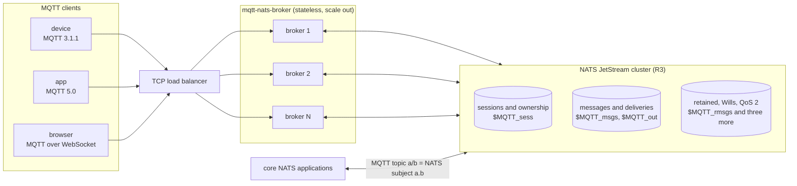
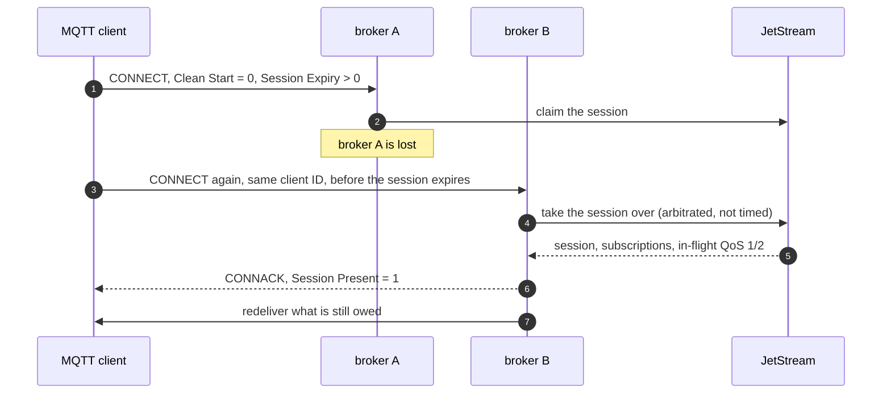
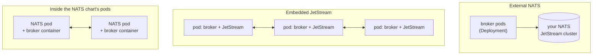

# mqtt-nats-broker

**An MQTT 3.1.1 and 5.0 broker that keeps every durable fact in NATS JetStream.**
Run as many broker instances as your connections need, lose any of them, and your
clients reconnect to any other instance and resume their sessions, retained messages and
in-flight QoS 1/2 exchanges.

[](https://github.com/nberlee/mqtt-nats-broker/actions/workflows/ci.yml)
[](LICENSE)

> **Status: alpha.** The first release,
> [v0.1.0-alpha.1](https://github.com/nberlee/mqtt-nats-broker/releases/tag/v0.1.0-alpha.1),
> shipped on 2026-11-22. Alpha promises no compatibility between versions; each break
> is decided case by case and named in [CHANGELOG.md](CHANGELOG.md). The roadmap is
> [docs/ROADMAP.md](docs/ROADMAP.md).

## Why this broker

nats-server ships an MQTT 3.1.1 listener inside the server. This project runs MQTT as
its own service in front of a JetStream cluster, so you get **MQTT 5** and
**JetStream-grade durability** without carrying a fork of nats-server.

| | What you get |
|---|---|
| **Stateless frontends, real HA** | Sessions, subscriptions, retained messages, delayed Wills and QoS 1/2 exchanges live in replicated JetStream streams. Brokers scale horizontally behind a plain TCP load balancer; a client reconnecting to another instance takes its session over, and a delayed Will the broker has durably enqueued fires from whichever broker is alive when it falls due. |
| **Correctness first** | Session ownership between brokers is arbitrated in JetStream with conditional writes and atomic batches, not by timeouts. Every known behavior gap is written down in [docs/CONFORMANCE.md](docs/CONFORMANCE.md), and a defect found in the data layer is reproduced against a real nats-server and tracked in [docs/known-upstream-issues.md](docs/known-upstream-issues.md), never papered over. |
| **Conformance you can rerun** | 124/124 MQTT 3.1.1 and 106/106 MQTT 5.0 normative checks pass, and the Eclipse Paho interoperability suite runs in CI on every push. |
| **Cloud native** | `FROM scratch` multi-arch images, non-root, read-only root filesystem, health and readiness endpoints, graceful draining shutdown, live TLS certificate rollover, structured logs and a Helm chart. |
| **Your NATS, your rules** | MQTT credentials pass through to NATS: each client is held to its own NATS identity's publish and subscribe permissions, on every path including retained messages and Wills. |
| **Pick a topology** | Put the broker in front of a NATS cluster you already run, or run the image with JetStream embedded and no NATS deployment at all. |

## How it works



The brokers hold no durable state of their own. Seven broker-owned streams carry it,
replicated by JetStream (`-stream-replicas`, normally 3), and MQTT topics map onto
NATS subjects so core NATS applications can publish to and subscribe from MQTT clients
directly. [docs/ARCHITECTURE.md](docs/ARCHITECTURE.md) has the mechanism in full.

### Losing a broker



A session resumes when the client keeps it (MQTT 5: Clean Start 0 with a nonzero
Session Expiry Interval; MQTT 3.1.1: Clean Session 0) and reconnects with the same
client identifier before it expires. When both brokers are alive, the old connection is
closed with reason code 0x8E
(session taken over). The same applies between a TCP and a WebSocket connection of one
client identifier. A delayed Will that was durably enqueued survives the loss of its
broker: another broker publishes it once the claimant's lease runs out, at least once
rather than exactly once, while JetStream keeps quorum. A Will not yet enqueued when
its broker crashes can be lost
([details](docs/CONFORMANCE.md#delayed-will-suppression-the-will-anchor-and-what-still-escapes-it)).
A JetStream node failing is a separate event: the stream's Raft
group elects a new leader and the brokers carry on, as long as quorum survives.

## Deployment styles



| Style | Use it when | Start with |
|---|---|---|
| **External NATS** | you already run NATS, or want brokers and storage scaled separately | the binary, `ghcr.io/nberlee/mqtt-nats-broker`, or the Helm chart with `topology: external` |
| **Embedded JetStream** | you want one self-contained deployment: a single container, or a StatefulSet of three or more | `ghcr.io/nberlee/mqtt-nats-broker:<tag>-embedded`, or the Helm chart's default |
| **Shared pod** | you run the official NATS Helm chart and want the broker beside each server | the values file in [docs/deploy/nats-chart-shared-pod](docs/deploy/nats-chart-shared-pod/README.md) |

All of them run on Kubernetes ([docs/KUBERNETES.md](docs/KUBERNETES.md)), with
`/healthz` and `/readyz` probes, a drain on SIGTERM, and documented backup, restore,
upgrade and rollback procedures ([docs/OPERATIONS.md](docs/OPERATIONS.md)).

## Quickstart

A broker and a NATS server, from the repository:

```sh
docker compose -f test/conformance/docker-compose.yml up --build
```

One container with JetStream embedded, nothing else to run (every green commit on `main`
is also published as `main-embedded`, see
[Commit images](docs/INSTALLATION.md#commit-images)):

```sh
docker run --rm --read-only --cap-drop ALL -p 1883:1883 -p 8080:8080 \
  -v mqtt-data:/data -e MQTTNB_STREAM_REPLICAS=1 \
  -e MQTTNB_NATS_USER=service -e MQTTNB_NATS_PASS=change-me \
  -e MQTTNB_DEFAULT_USER=mqtt -e MQTTNB_DEFAULT_PASS=change-me-too \
  ghcr.io/nberlee/mqtt-nats-broker:0.1.0-alpha.1-embedded
```

In front of an existing NATS cluster, with `-stream-replicas` set to its JetStream
cluster size:

```sh
go build ./cmd/mqtt-nats-broker
./mqtt-nats-broker -nats nats://nats-1:4222,nats://nats-2:4222 -stream-replicas 3 -port 1883
```

On Kubernetes, from the published chart. The chart never creates its credentials Secret,
so create it first; the chart's
[Before installing](charts/mqtt-nats-broker/README.md#before-installing) lists the rest:

```sh
kubectl create secret generic mqtt-nats-broker-nats \
  --from-literal=user=<service user> --from-literal=password=<service password> \
  --from-literal=default-user=<anonymous user> --from-literal=default-password=<anonymous password>
helm install broker oci://ghcr.io/nberlee/charts/mqtt-nats-broker \
  --version 0.1.0-alpha.1   # one embedded broker with its own JetStream
```

The broker needs nats-server 2.15.2 (not 2.15.3) with one server option set; the
prerequisites and both images are in [docs/INSTALLATION.md](docs/INSTALLATION.md).

## Conformance

| Suite | Result |
|---|---|
| [vibesrc/mqttconformance](https://github.com/vibesrc/mqttconformance), MQTT 3.1.1 | **124 / 124** normative statements |
| [vibesrc/mqttconformance](https://github.com/vibesrc/mqttconformance), MQTT 5.0 | **106 / 106** normative statements |
| Eclipse Paho MQTT 5.0 interoperability | **26 / 27**; the one baselined test is a spec-permitted delivery choice |

Every suite runs in CI against the real broker binary, next to more than 3,400
end-to-end and protocol tests, three-node JetStream failover tests, and image and Helm
installs on amd64 and arm64. The details, and every residual stated as current
behavior, are in [docs/CONFORMANCE.md](docs/CONFORMANCE.md).

## Features

| Feature | 3.1.1 | 5.0 |
|---|---|---|
| QoS 0 / 1 / 2 | ✅ | ✅ |
| Retained messages | ✅ | ✅ |
| Persistent sessions (JetStream) | ✅ | ✅ |
| Shared subscriptions | — | ✅ QoS 0/1; QoS 2 experimental and not part of alpha |
| Will (+ delay) | ✅ | ✅ (delay) |
| Message / session expiry, reason codes, properties | — | ✅ |
| TLS / mTLS, live certificate rollover | ✅ | ✅ |
| Auth passthrough (per-client NATS authorization) | ✅ | ✅ |
| HA cross-instance session takeover | ✅ | ✅ |
| MQTT over WebSocket / secure WebSocket | ✅ | ✅ |

MQTT 5 is always enabled. A shared subscription requesting QoS 2 is granted QoS 1 for
the alpha, while non-shared QoS 2 is unchanged; the experimental shared QoS 2 code is
kept behind a test-only option
([roadmap chapter](docs/ROADMAP.md#p-shared-subscription-qos-2-post-alpha--maybe-someday)).

## Security in one minute

- **Credentials pass through to NATS.** An MQTT client's user name and password dial
  NATS as that user; the broker refuses an identity outside its service account and
  enforces that identity's publish and subscribe permissions on every route, including
  the stored, retained and Will paths. Anonymous clients use configured default
  credentials.
- **Permissions are read once, at CONNECT.** A changed ACL reaches the routes the
  broker serves for a client only when that client reconnects; that and the other
  residuals are in
  [docs/CONFORMANCE.md](docs/CONFORMANCE.md#authorization-of-the-authenticated-identity--closed-with-residuals).
- **Deny MQTT identities the internals.** The broker reserves `$MQTT.>`; deny it in
  both directions for every MQTT client identity, together with the JetStream API
  (`$JS.>`, and `$KV.>` and `$O.>` as default isolation). An MQTT topic maps onto a
  NATS subject, so without that ACL a client could publish to
  `$JS/API/STREAM/DELETE/$MQTT_sess`. The recommended ACL is
  `test/conformance/nats.conf`.
- **Least privilege for the broker itself.** The service identity's grants are listed
  in [Recommended NATS permissions](docs/ARCHITECTURE.md#recommended-nats-permissions).

The deployment guide, with user/password and operator (JWT) examples, is
[docs/AUTHENTICATION.md](docs/AUTHENTICATION.md).

## Documentation

- [Installation](docs/INSTALLATION.md): prerequisites, the binary, the container images
- [Configuration](docs/CONFIGURATION.md): every flag and environment variable
- [TLS](docs/TLS.md): TLS, mTLS, certificate rollover, secure WebSocket
- [Kubernetes](docs/KUBERNETES.md): the Helm chart, example manifests, HA sizing
- [Authentication and authorization](docs/AUTHENTICATION.md)
- [Migration](docs/MIGRATION.md) from nats-server's own MQTT listener
- [Operations](docs/OPERATIONS.md) and [Troubleshooting](docs/TROUBLESHOOTING.md)
- [Architecture](docs/ARCHITECTURE.md), [Conformance](docs/CONFORMANCE.md) and
  [Provenance](docs/PROVENANCE.md)

The same documents are published as the project's GitHub Wiki at each release
([docs/WIKI.md](docs/WIKI.md)).

## Development

```sh
make test          # unit + end-to-end tests (real MQTT client over JetStream)
make vet lint      # static analysis
make full-suite    # upstream MQTT suite + harness-based tests (tag mqtt_fulltests)
make docker        # build the container image
make image-smoke-external  # build it and run it as a pod would (needs Docker)
make image-smoke-embedded  # the same for the embedded-NATS image, including a 3-node cluster
```

See [CONTRIBUTING.md](CONTRIBUTING.md).

## License & attribution

Apache-2.0. Substantial portions are derived from
[nats-io/nats-server](https://github.com/nats-io/nats-server) (Apache-2.0); see
[NOTICE](NOTICE) and, for the source revision and what changed,
[docs/PROVENANCE.md](docs/PROVENANCE.md).
